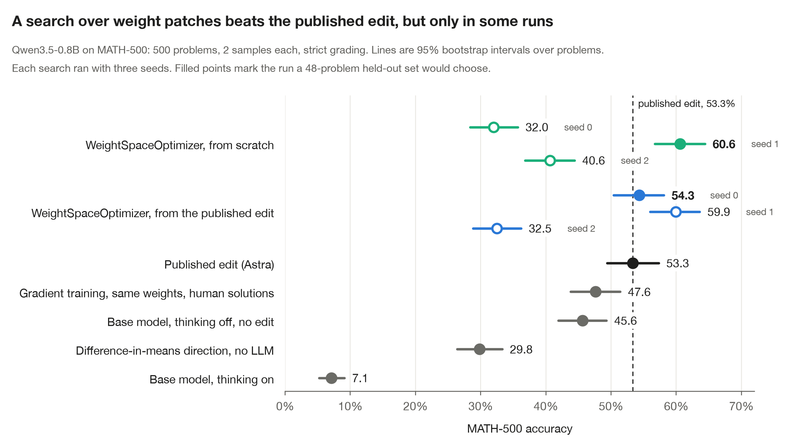

# dspy-weightspace

Weight-space programming as a DSPy optimizer. A frontier model reads the weights of a small local model, probes it
with a few forward passes, and writes a patch script. GEPA decides which patches to keep. Nothing is trained.

On Qwen3.5-0.8B, the best run of this search scores 60.6% on MATH-500, against 53.3% for the published edit. The
worst run of the same search scores 32%, so the [results](#results) are mostly about how to tell the two apart.

The idea comes from the MIT CSAIL post ["Sparks of Weight-Space Programming"](https://rikiyat.github.io/blog/weight-space-programming/)
(Takehi, Teoh, Zhang, Khattab, 2 Nov 2026). In that post GPT-6 Astra edited 0.016% of the weights of Qwen3.5-0.8B, and
the model stopped looping in its reasoning. The loop in the post works the way GEPA does. It evaluates, reflects,
proposes a change and keeps the best candidates. GEPA changes a string, and a weight patch can be a string too, as a
short script that edits named tensors. So the GEPA engine can drive the search without changes.

| Optimizer | What changes | Cost | Reversible |
|---|---|---|---|
| `dspy.GEPA` | instruction text | LLM calls | yes |
| **`WeightSpaceOptimizer`** (this repo) | sparse weight patch | LLM calls + a few forward passes | yes, patch is a diff |
| `dspy.BootstrapFinetune` | all weights | GPU training job | no |

`WeightSpaceOptimizer` is a DSPy `Teleprompter`. Its `compile()` runs the GEPA engine (`gepa.optimize`) through
`WeightSpaceAdapter`, whose only component is a weight-patch script. It does not use `dspy.GEPA`, which evolves
instruction text.

## Results



The model is Qwen3.5-0.8B and the test is MATH-500 with the original evaluation's settings: all 500 problems, 2 samples
each, thinking on, 32,768 new tokens, T=0.6, top-p 0.95, top-k 20 and presence penalty 1.5. Grading is strict, so a
generation that never closes its thinking gets no answer. The search behind the green and blue points used Claude
Opus 5.5 as the reflection model and 160 metric calls. It selected edits on MATH train problems at levels 3 to 5,
which do not overlap with MATH-500, at 16,384 tokens with the test's sampling.

What the chart shows:

1. **The search can beat the published edit.** The best run from scratch scores 60.6%. That is 7.3 points above the
   published edit (paired 95% interval 4.6 to 10.0), with 23% fewer tokens per correct answer. The best run that
   started from the published edit scores 59.9% (+6.6, interval 3.9 to 9.3).
2. **One run tells you little.** The same configuration scores anywhere from 32% to 61%. Three of the six runs fall
   below the unedited model with its thinking off (45.6%).
3. **A held-out set finds the good runs, and GEPA's own score does not.** Across the six runs, accuracy on 48 held-out
   problems has a rank correlation of 0.90 with MATH-500. The selection score that GEPA optimizes has 0.46. Inside
   one run the selection score works, because every child candidate did at least as well on the held-out set as its
   parent. It fails when you compare runs. Choosing by held-out score picks the filled points, 60.6% and 54.3%.
4. **Simpler methods fall short.** A difference-in-means direction, placed like the published edit, scores 29.8%.
   Gradient training on the same 131k weights reaches 47.6%, and only with human-written solutions to learn from.
5. **Selection data must look like the test.** Earlier runs selected on short GSM8K problems. Their edits scored about
   15% on MATH-500.
6. **The edits that work make the model conclude.** Every strong edit makes `</think>` and words like "So" 4 to 7.5
   times more likely at a sentence end. Weak edits mostly make "Wait" a little less likely.

The best edit from scratch removes one repetition direction from the output of every MLP and attention block in
layers 10 to 22. The best edit from the published one keeps it and scales four "Wait"-suppressing columns by 1.5.

`scripts/make_readme_chart.py` draws the chart from the per-problem result files and stops if an accuracy differs from
the recorded one. The older GSM8K numbers in `evidence/` used a lenient grader that counted answers inside unfinished
thinking. On MATH-500 that grader raised the base model from 8.0% to 21.6%, so do not compare them with the chart.

## How it works

```python
from dspy_weightspace import HFLocalLM, MathSolver, WeightSpaceOptimizer, load_math, math_metric
from dspy_weightspace.reflection import databricks_lm

lm = HFLocalLM("Qwen/Qwen3.5-0.8B")  # in-process, keeps a CPU copy of the original tensors
student = MathSolver(lm, max_new_tokens=16384)

# Three disjoint sets. The reflection model probes and reads feedback on the first, GEPA selects on the second,
# and you choose between runs on the third. Keep the test set out of all three.
dev, holdout = load_math(n_dev=48, n_holdout=48)  # MATH train, levels 3 to 5
feedback, selection = dev[:16], dev[16:]

runs = []
for seed in (0, 1, 2):
    opt = WeightSpaceOptimizer(
        math_metric,
        reflection_lm=databricks_lm("databricks-claude-opus-5-5"),
        passes_per_round=8,
        max_metric_calls=160,
        seed=seed,
        log_dir=f"runs/seed{seed}",
    )
    runs.append(opt.compile(student, trainset=feedback, valset=selection))
    lm.reset()
# score each run's patch on `holdout` and keep the best

optimized = runs[0]
optimized.patch_src  # standalone script that reproduces the edit from original weights
optimized.weights_changed  # how many entries differ
optimized.edited_tensors  # which tensors
```

For long traces, pass `gen_backend=VLLMBackend(model_dir)` (`dspy_weightspace/vllm_backend.py`) to `HFLocalLM`. Patches
are copied into the vLLM engine in place, and generation is about ten times faster than Hugging Face `generate` on
this model. `databricks/run_air.py` is the full script behind the chart. It also scores each candidate on the
held-out set after the search ends.

Pieces, in `dspy_weightspace/`:

- `hf_lm.py` `HFLocalLM`: in-process transformers model with `apply_patch` / `reset`, batched generation that keeps
  `finish_reason`, and residual-stream readout. Legacy `BaseLM.forward` for DSPy 3.4; `Engine` port is a follow-up.
- `sandbox.py` `PatchSandbox`: the blog's tool surface (`load`, `load_original`, `save_edit`, `drop_edit`, `edited`,
  `tok`) with its scope rules enforced: embeddings, output head and final norm are frozen, whole-tensor scaling is
  refused, gradients are off. Plus `save_artifact` / `load_artifact` so a final patch can reuse vectors found in exploration.
- `probes.py` `Probes`: budgeted forward passes. `generate` (original / edited / both with paired diff, optional
  activations) and `teacher_forced`.
- `proposer.py` `WeightPatchProposer`: the reflection model's session. System prompt adapted from the blog's. It replies
  with one ```python, ```forward or ```patch block per turn; the patch is validated in a fresh kernel before it becomes
  a GEPA candidate.
- `adapter.py` `WeightSpaceAdapter`: GEPA adapter whose only component is `weight_patch`.
- `vllm_backend.py` `VLLMBackend`: fast generation for selection, with in-place weight copies and prefix caching off.
- `steering.py`, `masked_ft.py`: the two baselines without a language model (difference-in-means direction, masked fine-tuning).
- `optimizer.py` `WeightSpaceOptimizer`: `Teleprompter.compile()` wired to `gepa.optimize`, Pareto selection.
- `published_edit.py`: rebuilds the Experiment-8 edit from the public `edit.npz` + `manifest.json`, sha256-checked.
- `metrics.py`, `data.py`, `program.py`, `baseline.py`: strict grading with math-verify, GSM8K and MATH subsets, the program under optimization, the table.

## Run it

Colab (free T4): [`notebooks/colab.ipynb`](notebooks/colab.ipynb). Needs `ANTHROPIC_API_KEY` in Colab secrets, or point
`reflection` at any Databricks Foundation Model API endpoint.

Databricks (serverless GPU job): [`databricks/README.md`](databricks/README.md). Reflection model auth comes from the
notebook context. Results land in MLflow and a UC volume.

Local:

```bash
uv sync --all-groups
uv run pytest
uv run python scripts/smoke_local.py --n 8 --max-new-tokens 2048   # loads the model, verifies the published edit, 3 rows
```

Apple silicon runs the 0.8B model on MPS. The Gated DeltaNet layers fall back to reference PyTorch kernels without
`flash-linear-attention`; correct, slower. On CUDA install `flash-linear-attention` for speed.

## Honest limits

- Removes obstacles, does not add skill. The blog's Gemma 3 270M follow-up, which rarely loops, got nothing. Expect the same.
- Open weights only. Nothing here applies to a model behind an API.
- Needs an eval gate. The blog's IFEval went 49 → 40 → 62 across 10/25/50 passes. Here, results swing from 32% to
  61% between seeds of the same search. Keep a held-out set apart from both `trainset` and `valset`.
- One model, one failure mode (thinking loops), one test set, one reflection model, three seeds per setup.
- "Native weight reading" at 0.8B means tool-assisted inspection in a Python kernel, as in the blog's Experiment 8.
- HF `generate` has no presence penalty; the blog used 1.5. Use the vLLM backend, which applies it, to match the test.

## Status

Prototype, updated 11 Nov 2026. Feature request text for `stanfordnlp/dspy` is in [`issue/`](issue/). Related work:
Drew Breunig's [`dspy-wsp`](https://pypi.org/project/dspy-wsp/) packages weight-space programming as a DSPy optimizer
too, and Matin Khajavi's [replication](https://github.com/MatinKhajavi/Weight-Space-Programming) reruns all eight
experiments of the original post with Claude Opus 5.5.

MIT.
